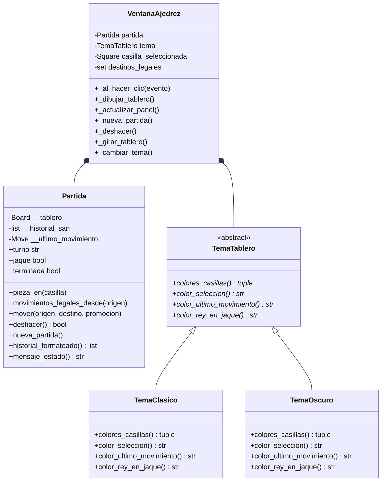

# Diagrama de clases

`TemaTablero` define el contrato visual. `TemaClasico` y `TemaOscuro` lo implementan, y `VentanaAjedrez` trabaja contra la abstracción. La ventana contiene una partida y el tema que se encuentra activo.
